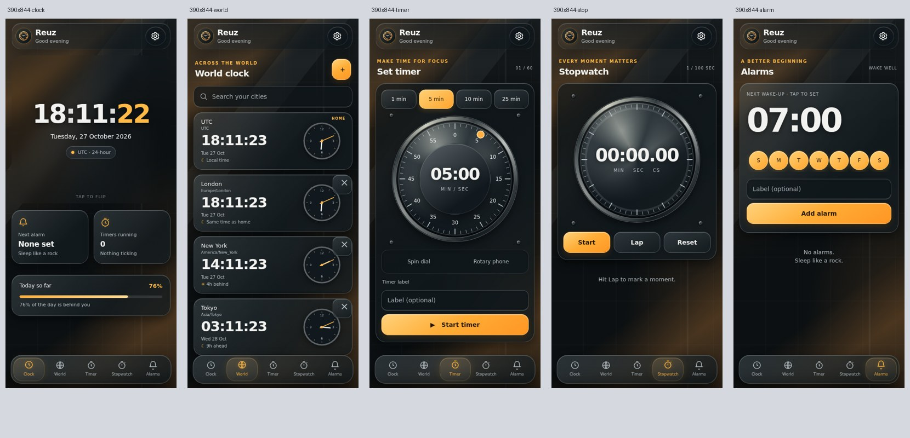

# Reuz

A clock app that Claude can control directly over a private MCP connection.

## What it does

- `/` shows a live clock page.
- `/api/clock` returns the current time as JSON.
- `/setup` creates your private connector URL. It works once, on the first visit.
- `/mcp/<token>` is the private endpoint Claude uses. Without the token it refuses everything.

Claude's tools:
- `get_clock` reads the time, timezone and format.
- `set_timezone` changes the timezone (any IANA name, e.g. `Asia/Kolkata`).
- `set_format` switches between `12h` and `24h`.

## One-time setup

1. Open `https://<your-worker-host>/setup` once, right after the first deploy.
2. Copy the connector URL it shows. It is displayed only once.
3. In Claude, go to **Settings → Connectors → Add custom connector** and paste the URL.

Whoever opens `/setup` first gets the connector URL, so do it right after deploy.

To replace the URL later, open `/setup/reset?token=<current token>`. Keep the URL somewhere safe, since the token is only shown once.

## Local development

```
npm install
npm test
npx wrangler dev --local
# open http://127.0.0.1:8787/setup, then:
BASE=http://127.0.0.1:8787 MCP_TOKEN=<token from /setup> scripts/smoke.sh
```


## Reuz 1.1 interface



The Android app and web clock share a charcoal, glass and amber interface: an open digital clock that flips to analog, detailed timer and stopwatch dials, city cards with live clock hands, and matching alarm and settings sheets. Appearance can be Dark, Light, or System and is saved on the device. Existing alarms, focus sessions, purchases and widgets keep their data.

The skin lives in `src/atelier.css.js`; `src/page.js` supplies the shared markup and behavior. `scripts/export-page.mjs` embeds both into the offline Android asset.

### Interface verification

Run `npm test` for clock/settings regressions. For mobile layout and interaction checks, install Playwright in a temporary directory, install its Chromium browser, then run:

```
NODE_PATH=/path/to/playwright/node_modules OUT=/tmp/reuz-previews node scripts/atelier-check.cjs
```

The check serves its own local fixture and covers 360px and 390px phones, landscape, navigation, city search, timers, stopwatch laps, alarms, settings and appearance persistence. The Android workflow runs these checks before building the APK and uploads the resulting interface previews.
